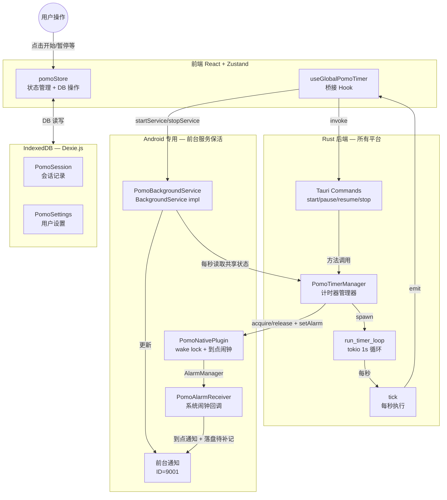
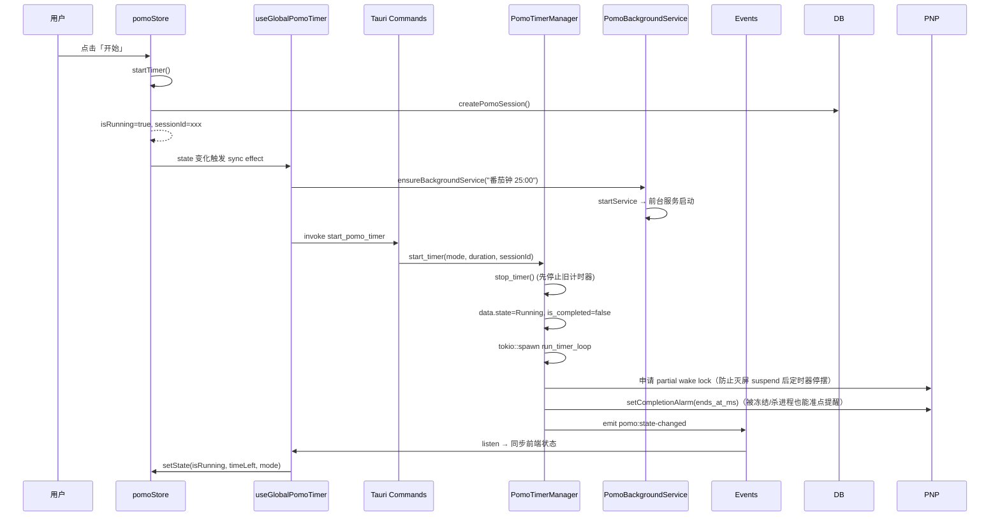
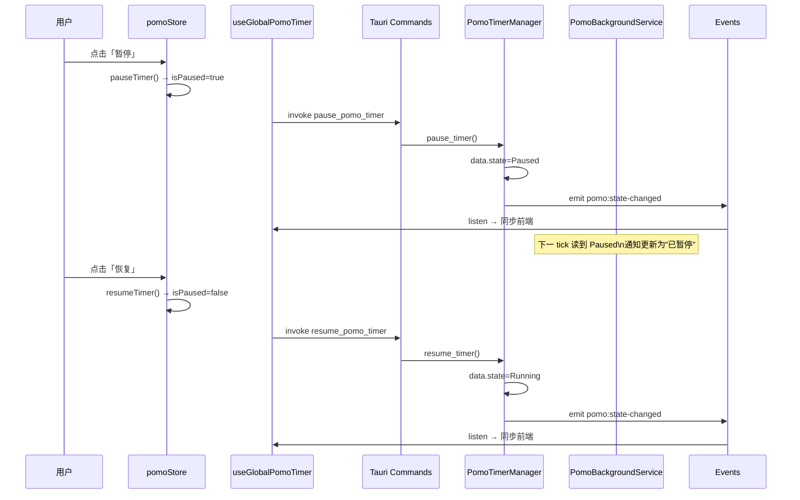
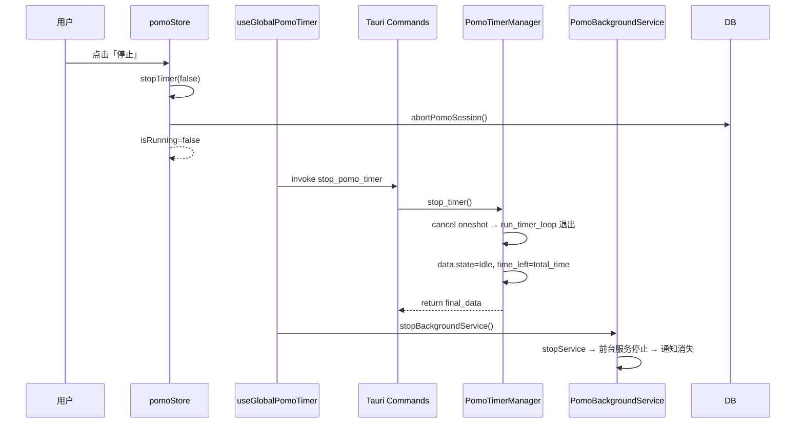
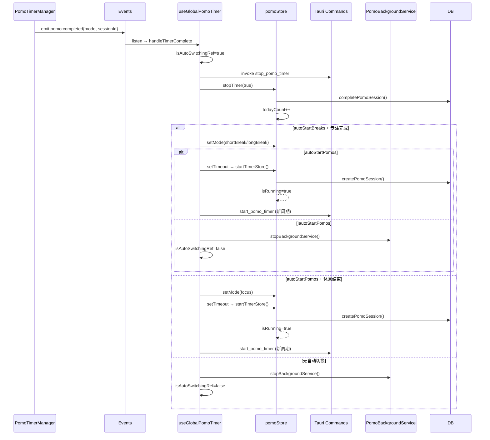
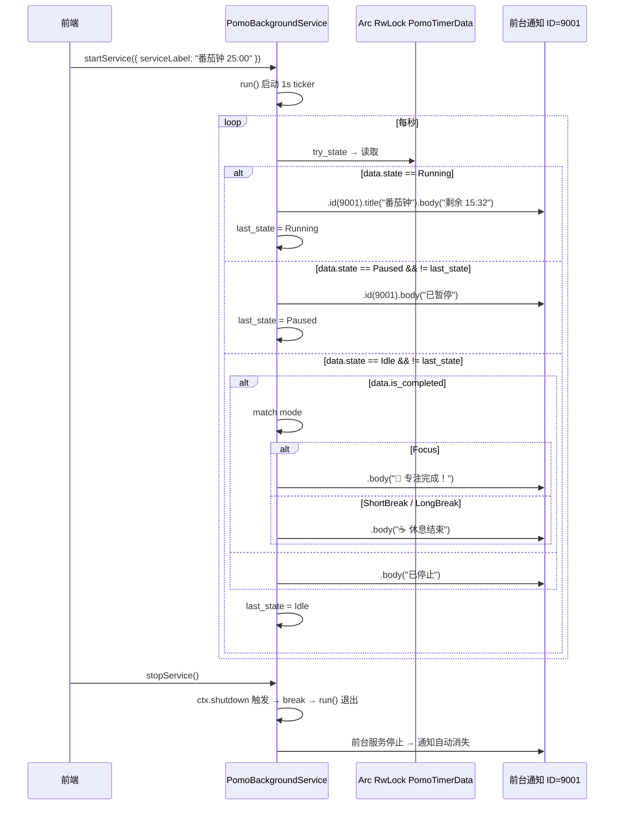

# Pomo 番茄钟系统文档

## 一、系统架构概览



> `PomoNativePlugin` / `PomoAlarmReceiver` **只由 Rust 调用**，不走前端 IPC。

---

## 二、完整生命周期

### 2.1 计时启动



### 2.2 暂停 & 恢复



### 2.3 主动停止



### 2.4 Tick 主循环 & 自然完成

```mermaid
flowchart TD
    START([run_timer_loop]) --> SELECT{tokio::select}
    SELECT -->|cancel_rx 收到| STOP[退出循环]
    SELECT -->|1s ticker| TICK[tick 函数]

    TICK --> CHECK_STATE{data.state == Running?}
    CHECK_STATE -->|否| CONT_RET[return true\n继续循环]

    CHECK_STATE -->|是| RECALC[time_left = 由 ends_at_ms 重算\n（不是 -1，漏 tick 可自愈）]
    RECALC --> EMIT_TICK[emit pomo:tick]

    EMIT_TICK --> CHECK_DONE{time_left <= 0?}
    CHECK_DONE -->|否| CONT_RET

    CHECK_DONE -->|是完成| DONE[计时完成]
    DONE --> SET_IDLE[state=Idle, time_left=0\nends_at_ms=None, is_completed=true]
    SET_IDLE --> CLEAR_TOKEN[clear cancel_token\n防止重复停止]
    CLEAR_TOKEN --> EMIT_COMPLETED[emit pomo:completed\n{ mode, sessionId, elapsed }]
    EMIT_COMPLETED --> NOTIF[原生发完成通知\n（前台时由前端播提示音）]
    NOTIF --> CLEAR_PENDING[清掉闹钟写下的「待补记」标记]
    CLEAR_PENDING --> EXIT_RET[return false\n退出循环]
```

> 注意：**剩余时间永远由 `ends_at_ms`（Unix 毫秒）重算，不再逐 tick 递减**。
> tokio 的 1 秒只有 `MissedTickBehavior::Delay` 的作用；正确性由时间戳保证 ——
> 否则设备 suspend（`CLOCK_MONOTONIC` 停走）或被系统冻结时会永久丢时间。

### 2.5 完成处理 & 自动切换



---

## 三、Android 保活 & 通知系统



### 3.1 wake lock + 到点闹钟（缺一不可）

前台服务只保证「进程不被杀」，**不阻止 CPU 睡眠**，所以在部分定制 ROM 上还需要两条独立机制：

| 机制 | 解决的问题 | 实现 |
|------|-----------|------|
| `PARTIAL_WAKE_LOCK` | 灭屏后 CPU suspend → tokio 定时器停摆（倒计时数值与锁屏通知都会停滞） | `PomoNativePlugin.acquireWakeLock/releaseWakeLock`，由 `pomo_timer` 在 start/resume 申请、pause/stop 释放，并带 `剩余+60s` 超时兜底 |
| `AlarmManager` 精确闹钟 | **系统冻结整个进程**并禁用其 wake lock（实测 vivo OriginOS：灭屏约 30 秒后 `isFrozen=true`，wake lock 显示 `DISABLED`）→ 进程内任何定时器都不再运行，「到点提醒」会迟 | `PomoNativePlugin.setCompletionAlarm` → `PomoAlarmReceiver` 到点发高优先级通知；进程若已被杀，还把「待补记」写进 SharedPreferences，下次启动由 `take_pending_pomo_completion` 补记（会话记 completed 而不是 aborted） |

关键取舍与实测事实（2026-09-30，vivo PD2536 / OriginOS / Android 16）：

- 冻结发生时 `dumpsys activity processes` 显示进程 `isFrozen=true` 但 `curProcState=4 (fg-service)` —— **这不是 AOSP 行为**，是厂商省电模块忽略 FGS 直接冻结；加入 `deviceidle whitelist` 也无效。
- 因此「灭屏期间倒计时数值准确」依赖的是**截止时间戳**（回到前台/被闹钟唤醒后立刻自愈，实测灭屏 3 分钟后数值完全正确），而「到点提醒」依赖的是**闹钟**。
- 闹钟用 `setAlarmClock`（Doze 下会被唤醒、不受"每 9 分钟一次"限频）；没有精确闹钟权限时退化为 `setAndAllowWhileIdle`。权限用 `USE_EXACT_ALARM`（计时器/闹钟类应用自动授予，Android 13+）。
- 系统状态栏会出现闹钟图标，这是 `setAlarmClock` 的固有表现。

---

## 四、关键函数索引

| 函数 | 文件:行号 | 职责 |
|------|-----------|------|
| `now_ms()` / `remaining_secs()` / `sync_time_left()` | `pomo_timer.rs` 顶部 | 计时正确性的核心：用 Unix 时间戳（RTC）算剩余时间，而不是数 tick。 |
| `PomoTimerManager::start_timer()` | `pomo_timer.rs` | 停止旧计时器 → 写 `ends_at_ms` → 申请 wake lock → 设到点闹钟 → spawn `run_timer_loop`。 |
| `PomoTimerManager::pause_timer()` | `pomo_timer.rs` | 先把剩余秒数落下来、清 `ends_at_ms`，再 `state = Paused`；释放 wake lock + 撤闹钟。 |
| `PomoTimerManager::resume_timer()` | `pomo_timer.rs` | 按剩余秒数重算 `ends_at_ms`，重新申请 wake lock + 重排闹钟。 |
| `PomoTimerManager::stop_timer(app)` | `pomo_timer.rs` | 发 cancel 信号，重置 `state=Idle`, `time_left=total_time`, `ends_at_ms=None`；释放 wake lock + 撤闹钟。**不碰 `is_completed`**。 |
| `PomoTimerManager::get_data()` | `pomo_timer.rs` | 权威快照：返回前先按 `ends_at_ms` 刷新 `time_left`。 |
| `PomoTimerManager::from_data()` | `pomo_timer.rs` | 使用外部 `Arc<RwLock<PomoTimerData>>` 构造（Android 共享）。 |
| `get_timer_manager()` | `pomo_timer.rs` | 从 managed state 获取或创建 `PomoTimerManager`（惰性初始化）。 |
| `run_timer_loop()` | `pomo_timer.rs` | `tokio::select!` 循环（`MissedTickBehavior::Delay`），等待 cancel 信号或每秒 tick。 |
| `tick()` | `pomo_timer.rs` | 每秒：重算 `time_left` → emit `pomo:tick` → 到点则发 `pomo:completed` + 原生提醒 + 清「待补记」。 |
| `pomo_native::acquire_wake_lock/release_wake_lock` | `pomo_native.rs` | 调 `PomoNativePlugin` 申请/释放 partial wake lock（非 Android 空操作）。 |
| `pomo_native::set_completion_alarm/cancel_completion_alarm` | `pomo_native.rs` | 设/撤到点精确闹钟。 |
| `pomo_native::take_pending_completion` | `pomo_native.rs` | 取出「离开期间到点、但进程已被杀」的补记记录（命令 `take_pending_pomo_completion`）。 |
| `PomoAlarmReceiver.onReceive()` | `PomoAlarmReceiver.kt` | 系统闹钟回调：发完成通知 + 写「待补记」（应用在前台则不发通知）。 |
| `PomoNativePlugin` | `PomoNativePlugin.kt` | wake lock / 闹钟 / 通知的原生实现；只由 Rust 调用，不暴露给前端。 |
| `PomoBackgroundService::run()` | `pomo_background.rs` | 1s 循环，读取共享 data，用 `.id(9001)` 更新前台通知。 |
| `ensureBackgroundService()` | `useGlobalPomoTimer.ts` | 前端的 Android 保活启动封装（`specialUse` 类型），失败会打日志。 |
| `handleTimerComplete()` | `useGlobalPomoTimer.ts` | 处理 `pomo:completed`：停止计时器（用后端给的 `elapsed`）、更新 DB、自动切换模式。 |
| `pullBackendState()` | `useGlobalPomoTimer.ts` | 冷启动 / 页面重新可见时拉一次权威快照（不再依赖从不触发的 `app:resumed`）。 |
| `abortStalePomoSessions()` | `pomoService.ts` | 收尾进程被杀时残留的 `running/paused` 会话。 |
| `stopTimer()` (store) | `pomoStore.ts` | 完成或中止 DB Session；`actualDuration` 优先用后端 `elapsed`。 |

---

## 五、事件表

| 事件名 | 方向 | 触发时机 | payload |
|--------|------|----------|---------|
| `pomo:tick` | Rust → 前端 | 每秒，正在运行时 | `{ timeLeft, totalTime, state, mode, sessionId }` |
| `pomo:state-changed` | Rust → 前端 | start/pause/resume/stop | `{ timeLeft, totalTime, state, mode, sessionId }` |
| `pomo:completed` | Rust → 前端 | 倒计时归零 | `{ mode, sessionId, elapsed }` |
| `pomo:native-error` | Rust → 前端 | 原生能力（wake lock / 闹钟）调用失败 | `string`（错误信息） |

> 旧文档里的 `app:resumed` 已删除：`tauri 2.10` 里不存在 `AppEvent::Resumed` 这个事件名，监听从不触发。
> 现在改用「页面重新可见（`visibilitychange`）→ 主动拉一次 `get_pomo_timer_state`」。

---

## 六、PomoTimerData 字段表

| 字段 | 类型 | 序列化 | 说明 | 写者 |
|------|------|--------|------|------|
| `state` | `TimerState` | `idle/running/paused` | 计时器状态 | `start_timer` = Running, `pause_timer` = Paused, `resume_timer` = Running, `tick`(完成) = Idle, `stop_timer` = Idle |
| `mode` | `PomoMode` | `focus/shortBreak/longBreak` | 当前模式 | `start_timer` |
| `time_left` | `i64` | seconds | 剩余秒数，**由 `ends_at_ms` 重算** | `start_timer` = duration；`tick` / `get_data` 每次重算；`tick`(完成) = 0；`stop_timer` = total_time |
| `total_time` | `i64` | seconds | 总时长 | `start_timer` = duration |
| `ends_at_ms` | `Option<u64>` | number/null | 截止时间（Unix 毫秒）。Running 时唯一的时间真身 | `start_timer`/`resume_timer` 写入；`pause_timer`/`stop_timer`/完成时清空 |
| `session_id` | `Option<i64>` | number/null | 数据库 Session ID | `start_timer` |
| `task_id` | `Option<String>` | string/null | 关联任务实例 ID（随完成记录落盘，供被冻结/被杀后补记） | `start_timer` |
| `is_completed` | `bool` | true/false | 是否自然完成 | `tick`(完成) = true, `start_timer` = false; **stop_timer 不碰** |
